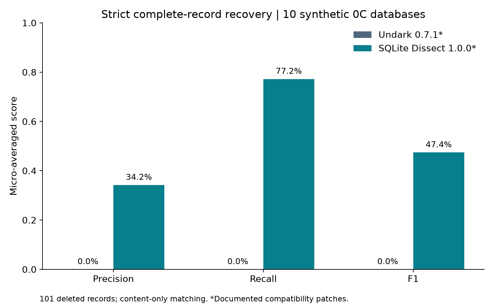
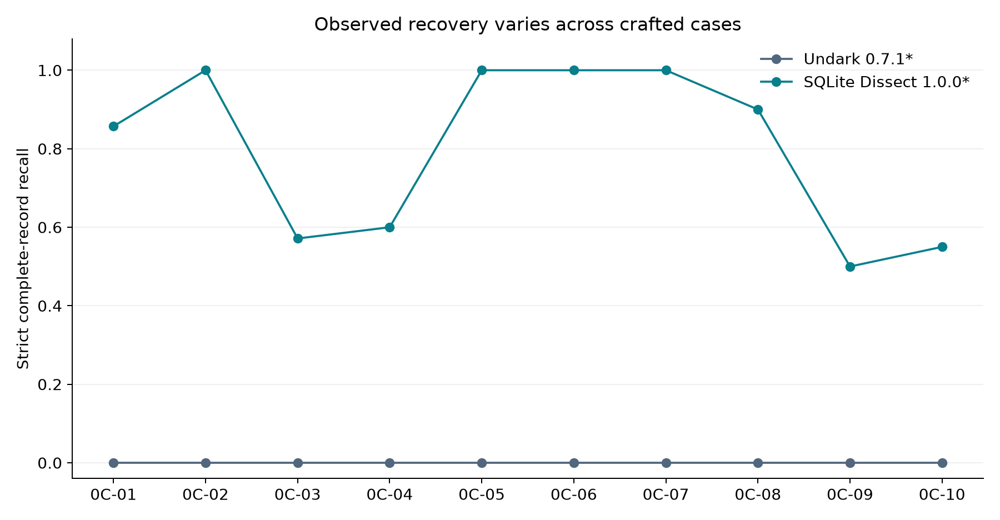

# Evaluating the Reliability of Deleted-Record Recovery in SQLite Databases
## A Reproducible Pilot Study on the SQLite Forensic Corpus

**Research portfolio:** Dezhang Li  
**Experiment date:** 21 October 2026  
**Status:** Computational pilot completed; draft for researcher review. Implementation and drafting were assisted by an AI research assistant. No researcher approval, independent replication or publication is claimed.

## Abstract

Deleted-record recovery requires more than producing readable fragments: recovered values must correspond to known deleted records. This pilot compares two independent implementations, Undark and SQLite Dissect, using ten category 0C databases from the public SQLite Forensic Corpus v2.0. Publisher XML labels were checked against SQL construction statements, database schemas and surviving records. The resulting reference set contains 101 deleted records. With complete ordered-value matching, exact integer/text comparison and an absolute REAL tolerance of 0.00001, SQLite Dissect achieved 78 true positives, 150 false positives and 23 false negatives. Its micro precision, recall and F1 were 34.21%, 77.23% and 47.42%. Undark produced no complete matches under that endpoint, although ten records met a conservative partial-recovery definition. Both tools required disclosed compatibility patches. Floating-point sensitivity and observed failure examples qualify the comparison. These results describe specific builds and crafted inputs, not reliability in real investigations.

## 1. Introduction

A database query exposes logically available records. Recovery software instead searches remaining bytes for information that the database no longer presents as live rows. An apparently plausible output may contain only part of an original record, altered numeric values, or fields assembled from an incorrect boundary. A useful evaluation therefore needs independent reference answers and a transparent definition of success.

This project is research training for a computer science portfolio. Its contribution is a small executable evaluation pipeline, rather than a new recovery algorithm. The pipeline connects public data acquisition, reference validation, actual tool execution, one-to-one scoring, error inspection and reproducible figures.

Three questions guide the study. **RQ1:** How do complete-record precision, recall and F1 differ between the selected tools? **RQ2:** How do observed outcomes vary across deletion and storage conditions in the selected cases? **RQ3:** Which kinds of partial, incorrect and missing outputs occur? The scope is deliberately restricted to category 0C. Overwritten records, overflow-page recovery, anti-forensic modifications, private phones and real-case evidence are outside the experiment.

## 2. Related Work

Nemetz, Schmitt and Freiling introduced a standardized collection of crafted SQLite examples with supporting documentation and evaluated several analysis tools. Their reported difficulties with deleted records and numeric fields motivate explicit field-level correctness checks rather than treating every recovered fragment as a correct row. Their study also distinguishes database viewing from recovery. The present work uses the corpus but does not reproduce their tool set or claim directly comparable historical scores [1].

Meng and Baier proposed a structural recovery approach in bring2lite. Their discussion connects deletion behavior to database settings and examines additional sources such as journal information. That work motivates reporting input conditions and avoiding the assumption that every deletion leaves equivalent recoverable material. bring2lite is related work here, not an experimentally evaluated tool [2].

SQLite's official format specification describes record headers, serial types and freeblocks. A freeblock begins with four bytes describing its successor and size; record payload interpretation depends on valid boundaries and types. These structures provide context for investigating fragments and decoding errors, without proving a particular failure mechanism merely from a missing output [3]. Undark and SQLite Dissect are publicly inspectable implementations. Their pinned source revisions and commands are recorded rather than relying on an unspecified “latest version” [4,5].

## 3. Data and Methods

### 3.1 Acquisition and eligible cases

The official Digital Corpora page and its S3 hosting documentation identify the public distribution [6,7]. The downloaded ZIP was 5,370,116 bytes, below the authorized 20 MB limit. Its SHA-256 is `8d71ff0ca595716b60ca7b6e9f0c7789e4612383f230e3742c9fc06ad39e95d8`. The package licence is CC0 1.0 Universal. Extraction rejected unsafe paths, links and oversized expansion; corpus SQL was never executed.

The archive contains 557 files, including 141 databases with matching SQL and XML files. All 556 entries in the supplied checksum list passed; the list does not hash itself. The package history identifies v2 as 77 original examples plus 64 anti-forensic examples. The retained 0C XML documents identify their original v1 provenance, which is consistent with that distribution history.

All ten 0C cases qualified for this endpoint. Together they contain 16 tables, 101 deleted records and 189 live records. Files are only 8,192 or 12,288 bytes. The other 131 databases were not evaluated for eligibility and are not labeled unusable.

| Case | Tables | Live rows | Deleted rows | Value layout |
|---|---:|---:|---:|---|
| 0C-01 | 1 | 13 | 7 | Five integers |
| 0C-02 | 2 | 30 | 10 | Five integers |
| 0C-03 | 1 | 13 | 7 | Integer, two text fields |
| 0C-04 | 2 | 30 | 10 | Integer, two text fields |
| 0C-05 | 2 | 30 | 10 | Integer, two text fields, two integers |
| 0C-06 | 1 | 13 | 7 | Integer, four REAL fields |
| 0C-07 | 2 | 30 | 10 | Integer, four REAL fields |
| 0C-08 | 2 | 30 | 10 | Integer, two text fields, two REAL fields |
| 0C-09 | 1 | 0 | 10 | Integer, two text fields, two REAL fields |
| 0C-10 | 2 | 0 | 20 | Integer, two text fields, two REAL fields |

### 3.2 Independent reference validation

XML rows marked `deleted="1"` supply the deleted-record references. The reader verifies declared counts and column order, parses literal SQL INSERT values, checks DELETE identifiers or whole-table deletion, and compares surviving XML rows with read-only SQL queries. Database integrity checks also pass. The construction scripts disable secure deletion before the relevant deletions; the experiment does not regenerate these databases with a modern SQLite engine.

No reference vector duplicates another deleted vector or overlaps a surviving vector within a case. Both tables in a multi-table case have compatible ordered type layouts. These checks support a content-only endpoint: all column values must match, but recovered table identity and internal SQLite rowid are not evaluated. This restriction is necessary because Undark does not provide equivalent table attribution. It must not be interpreted as complete reconstruction of database relationships.

### 3.3 Tools and execution

Undark 0.7.1 was built from commit `2e0bd78bcb92597362c1fd93d0e392afe1adcbaa`. Its local `ntohll` function was renamed to avoid a macOS macro collision. SQLite Dissect 1.0.0 was installed from commit `6c0a742d70c27c3b48fd0bd275eac6bf21f96737`. Its unpatched carving path raised a string/bytes exception. Three empty hash-accumulator initializations were changed to byte strings, allowing execution without changing candidate selection or value decoding. The patch and initial failures remain available. Results apply to these disclosed builds, not untouched releases.

Both tools received the same read-only database bytes, without reference SQL/XML or journal sidecars. Undark ran with `-i DATABASE`; Dissect used `-n -c -f -e csv -d OUTPUT`. Each invocation had a 60-second timeout. Hashes after execution verified unchanged database inputs. The host used Python 3.13.2; platform, compiler, dependencies and versions are retained in the run manifest. Elapsed times were logged for traceability, not interpreted as a performance benchmark.

Development first used 0C-01, 0C-03, 0C-05 and 0C-09. The procedure then covered all ten cases and was repeated for consistency. Development cases remain in the final descriptive analysis. There was no training, holdout evaluation or preregistration. A proposed earlier development/test split was replaced openly because this is a small exploratory pilot.

### 3.4 Scoring

The primary unit is an ordered vector of column values. Integer and text values must match exactly. REAL values allow absolute error at most 0.00001, with no relative tolerance, consistent with the five-decimal reference literals while allowing small representation differences. A candidate can match at most one reference; repeated candidates cannot repeatedly earn credit.

Dissect's explicitly allocated rows are excluded from recovery candidates. For either tool, candidates exactly matching independently queried live records are removed and counted separately. This removed two Undark outputs in the final run. Dissect exports overlapping carved fragments as individual candidates, whereas Undark uses a different scanning and export granularity. Candidate-level precision therefore reflects these configured output policies as well as complete-record correctness; it is not a universal ranking of forensic usefulness. Malformed values, wrong-length vectors and fragments otherwise remain candidates. No reference-based filter is used to delete unwanted predictions.

TP counts complete matches; FP counts remaining candidates; FN counts reference rows without a complete match. Precision is TP/(TP+FP), recall is TP/(TP+FN), and F1 is 2TP/(2TP+FP+FN). Aggregation sums these counts across cases before computing ratios. Undefined denominators remain missing. Execution failure would be recorded separately, rather than quietly assigned zero recovery.

Partial recovery is secondary: a candidate must identify one unmatched reference through its first-column ID and match at least one additional field. Complete matches take priority. Partial candidates still count as FP and their references as FN under the strict endpoint. Unanchored fragments remain incorrect or unattributed; this does not assert that every byte is fictitious. Eight unit tests cover duplicates, partial matching, precedence, invalid values, tolerance and empty output.

## 4. Results

### 4.1 Primary comparison

All 20 final tool/case invocations completed. The final comparison table is generated from `results/final-20261021/comparison.csv`.

| Tool, with disclosed patch | TP | FP | FN | Precision | Recall | F1 |
|---|---:|---:|---:|---:|---:|---:|
| Undark 0.7.1 | 0 | 29 | 101 | 0.00% | 0.00% | 0.00% |
| SQLite Dissect 1.0.0 | 78 | 150 | 23 | 34.21% | 77.23% | 47.42% |

*Figure 1. Micro scores computed directly from the final CSV. These measure strict complete value vectors, not whether any useful information was recovered.*

Undark produced 29 scored candidates. Ten were uniquely anchored partial recoveries; 19 were incorrect or unattributed. Ninety-one reference rows had neither a complete match nor an anchored partial match. Dissect produced 228 scored candidates: 78 complete matches and 150 remaining candidates. None met the conservative partial definition, and 23 reference rows lacked a complete match. This does not imply Dissect never produced real fragments.

### 4.2 Variation across cases

Dissect recovered every deleted vector in 0C-02, 0C-05, 0C-06 and 0C-07, with no FP in those cases. In the three-column text cases, it recovered 4/7 and 6/10 references but generated 47 and 77 FP, respectively. Thus 124 of its 150 FP came from 0C-03/04. A single aggregate recall figure would conceal this large review burden.

*Figure 2. Case-level strict recall; the ten crafted databases are not independent random samples from real devices.*

Across eight partially deleted databases, Dissect recovered 62/71 references, giving 87.32% recall. In two wholly deleted databases it recovered 16/30, giving 53.33% recall. Layout, values and deletion patterns vary together, so this contrast does not estimate a causal effect of deleting an entire table's contents. Undark's strict complete-record recall was zero throughout, with anchored partial recovery concentrated in 0C-09/10.

### 4.3 Observed errors and sensitivity

In 0C-09, Undark exported ID 20006 with a REAL value of 2055417409.658203 instead of 2055417409.65816. The expected double's bytes remain at file offset 7996. Reproducing the pinned source's integer-bit-pattern conversion through a numeric double yields 2055417409.6582031, matching the exported six-decimal value. This supports a conversion-loss explanation for this specific discrepancy. Another row exports `König` as `K..nig`, consistent with the source's byte-wise printable-character substitution.

Dissect's 0C-03 output includes `[24942, "n", ""]` at offset 7863, close to a correct `[20017, "Nele", "Baumann"]` candidate at offset 7853. Such overlapping fragments explain why readable residual content is not sufficient evidence of a correct row. A separate warning in 0C-10 reports a failed candidate carving at offset 7833 despite successful process exit; that warning remains in stderr.

Post-hoc REAL-tolerance sensitivity qualifies Undark's zero primary score. At 0.0001 tolerance it has two complete matches; at 0.001 it has eight, giving 27.59% precision, 7.92% recall and 12.31% F1. Dissect's counts remain unchanged at both thresholds. These exploratory results do not replace the original endpoint or justify silently rounding away recovery errors.

Repeated execution yielded identical per-case scores. The main and repeat raw Undark outputs were also identical; Dissect's observed stderr difference was a warning timestamp. Raw logs, hashes and record-level matches are retained, allowing inspection beyond aggregate scores.

## 5. Discussion

For RQ1, Dissect recovered more complete reference vectors in the tested configuration, but its precision was limited by extra candidates. The practical lesson is to separate recovery coverage from the effort required to verify outputs. A tool that emits many plausible fragments can have useful recall while still providing unreliable row-level suggestions without further inspection.

For RQ2, observed differences across schemas and deletion scenarios are substantial. Nevertheless, ten deliberately crafted examples cannot isolate individual factors. The text-only cases combine short schemas and particular residual layouts; the fully deleted cases also have their own values and storage patterns. A future controlled study would vary one factor while holding others fixed and would include new generated data reserved from adapter development.

For RQ3, errors include altered floating-point values, changed text bytes, wrong record shapes, overlapping fragments, missing complete records and a handled carving failure. The numeric reproduction gives stronger mechanistic evidence than simply observing a mismatch. Explanations for other failures remain hypotheses. In particular, absence from both tools' outputs does not establish that the information is physically unrecoverable.

Several limitations constrain interpretation. Both builds required compatibility changes, one platform was tested, and the analysis excludes journal artifacts. The endpoint ignores table attribution and uses a conservative partial rule that misses useful fragments without intact IDs. Strict numeric fidelity strongly affects Undark's score; the sensitivity analysis exposes that dependence. No manual post-filter or confidence threshold was optimized against the answers. Consequently, FP here means failure to satisfy the complete-record endpoint, not proof that the tool fabricated every residual byte.

The corpus is synthetic and small. Records within a database and related cases share construction patterns, so treating 101 rows as independent trials would overstate statistical evidence. No confidence intervals, significance tests or real-case accuracy claims are made. Reproducibility is demonstrated locally through pinned inputs, commands, tests and repeated scores; cross-platform replication remains future work.

## 6. Conclusion

This pilot completed a real path from lawful public acquisition to reference validation, two-tool execution, scoring and explanatory figures. Dissect recovered 78 of 101 complete deleted vectors with substantial extra output; Undark recovered partially useful information but failed the strict full-vector endpoint. The tolerance analysis prevents that zero score from being mistaken for complete absence of useful recovery. The repository is prepared locally for researcher review. Publication and broader claims require a separate human decision; no remote repository has been created.

## References

1. Nemetz, S., Schmitt, S., & Freiling, F. (2018). A standardized corpus for SQLite database forensics. *Digital Investigation, 24*, S121–S130. [DOI: 10.1016/j.diin.2018.01.015](https://doi.org/10.1016/j.diin.2018.01.015). [DFRWS full text](https://dfrws.org/sites/default/files/session-files/2018_EU_paper_a_standardized_corpus_for_sqlite_database_forensics.pdf).
2. Meng, C., & Baier, H. (2019). bring2lite: A structural concept and tool for forensic data analysis and recovery of deleted SQLite records. *Digital Investigation, 29*, S31–S41. [DOI: 10.1016/j.diin.2019.04.017](https://doi.org/10.1016/j.diin.2019.04.017). [DFRWS full text](https://dfrws.org/wp-content/uploads/2019/06/2019_USA_paper-bring2lite_a_structural_concept_and_tool_for_forensic_data_analysis_and_recovery_of_deleted_sqlite_records.pdf).
3. SQLite Project. [Database File Format](https://sqlite.org/fileformat2.html). Accessed 21 October 2026.
4. Daniels, P. L. [Undark source repository](https://github.com/inflex/undark/tree/2e0bd78bcb92597362c1fd93d0e392afe1adcbaa). Version 0.7.1; pinned source plus disclosed portability patch.
5. Department of Defense Cyber Crime Center. [SQLite Dissect source repository](https://github.com/dod-cyber-crime-center/sqlite-dissect/tree/6c0a742d70c27c3b48fd0bd275eac6bf21f96737). Version 1.0.0; pinned source plus disclosed byte-string compatibility patch.
6. Digital Corpora. [SQLite Forensic Corpus](https://digitalcorpora.org/corpora/sql/sqlite-forensic-corpus/). Official dataset page. Accessed 21 October 2026; actual acquisition documented in `data/manifest.json`.
7. Digital Corpora. [S3 information](https://digitalcorpora.org/about-digitalcorpora/s3-information/). Official hosting documentation. Accessed 21 October 2026.
